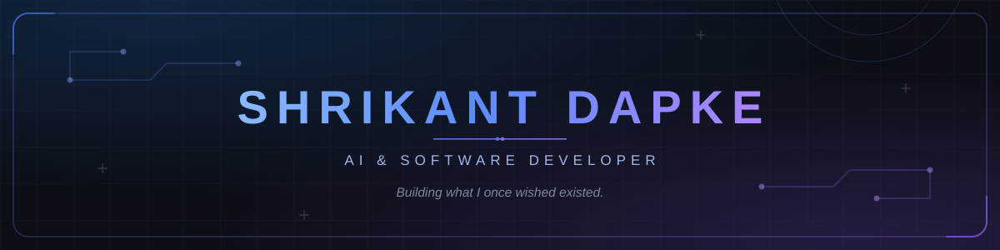
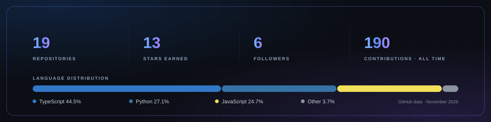

 

<a href="https://github.com/Shrikant-Dapke">GitHub</a> &nbsp;·&nbsp;
<a href="https://www.linkedin.com/in/shrikant-dapke/">LinkedIn</a> &nbsp;·&nbsp;
<a href="https://github.com/Shrikant-Dapke/J.A.R.V.I.S">J.A.R.V.I.S</a>

  

---

## 👋 About Me

I'm a Computer Science & Engineering student specializing in **Artificial Intelligence & Analytics** at **MIT ADT University, Pune**.

I'm a developer who enjoys building useful software and understanding the engineering behind it. My interests span full-stack development, AI-powered applications, intelligent automation, and desktop systems.

I like taking ideas beyond prototypes — designing architecture, building products, testing edge cases, and refining the experience.

> **Building what I once wished existed.**

**Areas of Interest:** AI Agents · Full-Stack Engineering · Desktop Applications · Local AI · Automation · System Architecture

## 🚀 Currently Building

### [J.A.R.V.I.S. — Just A Rather Very Intelligent System](https://github.com/Shrikant-Dapke/J.A.R.V.I.S)

An AI-powered desktop assistant designed to turn natural-language requests into structured tasks and execute them through controlled, verifiable tool interactions.

Rather than being just another chatbot, J.A.R.V.I.S. is built around planning, orchestration, execution, and verification.

- **Task Planning:** Converts user requests into structured execution plans.
- **Tool Orchestration:** Coordinates tools and bounded workflows.
- **Approval Gates:** Keeps sensitive actions under user control.
- **Voice Engine:** Integrates local speech recognition and speech generation.
- **Desktop Experience:** Electron, React, and TypeScript interface.
- **Local-First Architecture:** Designed around local models and services.

**Technology Stack:**

`Python` `FastAPI` `Electron` `React` `TypeScript` `sherpa-onnx` `Kokoro TTS`

[Explore J.A.R.V.I.S. →](https://github.com/Shrikant-Dapke/J.A.R.V.I.S)

## 💻 Selected Projects

| Project | Description | Focus |
| :--- | :--- | :--- |
| [J.A.R.V.I.S.](https://github.com/Shrikant-Dapke/J.A.R.V.I.S) | AI-powered desktop assistant with planning, tools, voice, and execution verification. | AI · Desktop |
| ShelfSense | Intelligent inventory management platform. | Full Stack · AI |
| DS Properties | Property and plotting business management system. | Full Stack |
| MuleGuard | Project focused on detecting and addressing mule-account and financial fraud risks. | AI · Security |

## 🛠️ Tech Stack

**Languages**

**Frontend & Backend**

**Databases & Tools**

## 🏆 Hackathons & Achievements

| Hackathon | Achievement |
| :--- | :--- |
| National AI/ML Hackathon — IIT Hyderabad | **6th Position · Top 10** |
| Foodscope Hackathon — IIIT Delhi | **Top 10**, selected among 84 offline finalists from 1,000+ teams |
| Revengers Hackathon | **Rank 7** |

## 💼 Experience

### DS Properties — Summer Internship & Freelance Project

Worked on a property and plotting business management system, contributing to the development of a practical software solution for business operations.

## 📊 GitHub Analytics

  

## 🤝 Let's Connect

  

Curious by nature. Intentional in design. Always building.

